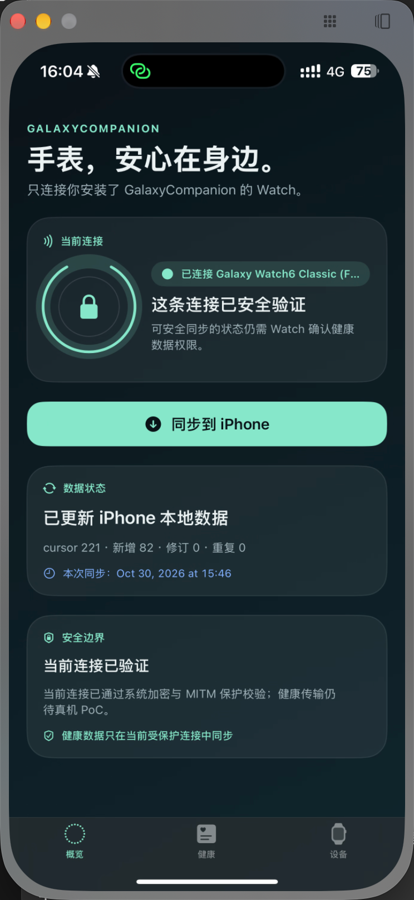
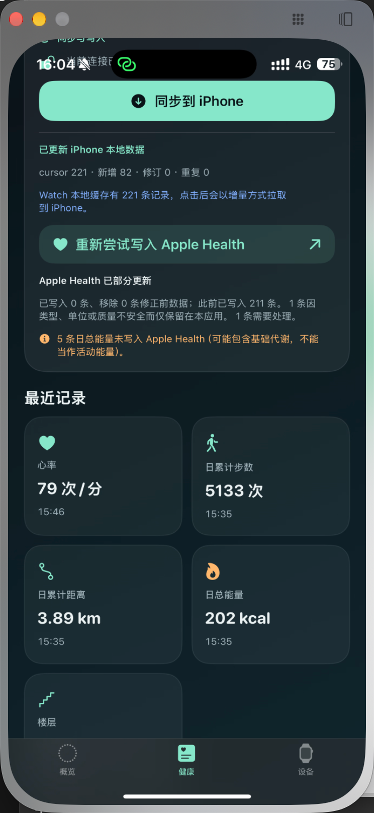
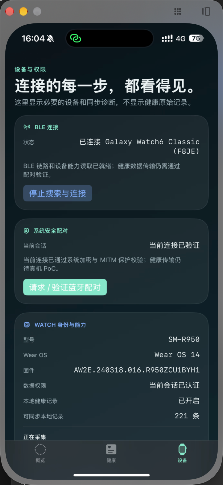

# GalaxyCompanion

> 中文在前 · English below

**GalaxyCompanion** is an experimental iPhone + Wear OS companion for a Galaxy Watch. It uses an app-owned BLE/GATT service—not Galaxy Wearable—to manually and securely pull health records collected by the Watch app into iPhone storage and, where meaningful, Apple Health.

> [!WARNING]
> This is an MVP / research project, not a medical device and not a replacement for Galaxy Wearable or Samsung Health. It does not reproduce Samsung sleep scores or sleep stages, and it does not promise access to Samsung Health cloud or historical data.

## Screenshots

| Overview / 概览 | Health / 健康 | Device & security / 设备与安全 |
| --- | --- | --- |
|  |  |  |

---

## 中文

### 项目是什么

GalaxyCompanion 让安装了自研 Wear OS App 的 Galaxy Watch，在用户主动操作时通过自有 BLE/GATT 服务把健康数据安全同步到 iPhone。它不依赖 Galaxy Wearable，也不要求日常同步期间保持 Android 手机在线。

当前真机 PoC 已在 **Galaxy Watch6 Classic（SM-R950）** 与 iPhone 上完成 BLE 发现、连接、GATT 能力读取、系统配对门校验和增量健康记录同步。其余与系统版本、权限、后台回调频率或 Apple Health 写入相关的行为仍以真机验证为准。

### 已实现

- 自有 BLE/GATT 服务发现、连接、断线后增量重拉与 MTU 分片传输。
- 当前 BLE 会话的系统加密 / MITM 配对门；未通过校验不传输健康记录。
- Watch 端基于公开 Wear OS Health Services 的低功耗被动本地缓存。
- 运行时能力探测；按手表实际能力选择心率、步数、距离、日总能量和楼层等安全指标。
- iPhone 本地持久化、cursor 增量同步、去重、修订处理与容量淘汰缺口提示。
- Apple Health 写入：心率、步数、距离和楼层仅在用户授权后写入。日总能量可能包含基础代谢，因此只保留在本应用内。
- 保守的本地睡眠估算：仅使用本应用提前采集到的真实夜间心率与细粒度活动增量，输出休息时段、预计时长和效率。
- Watch 端只有一个“启动”操作；BLE 连接仅在手表 App 前台、用户手动同步时开启，降低续航影响。

### 明确边界

- 不替代 Galaxy Wearable、Samsung Health、三星云、支付、eSIM、OTA、通话或消息回复。
- 不读取三星健康在手表或三星手机中的私有历史数据库；三星既有的睡眠评分、深睡 / 浅睡 / REM 不是本项目当前同步来源。
- 不将日累计步数伪装成夜间活动，也不会在数据不足时编造睡眠结果。
- 血氧、ECG、皮温、IBI/HRV、压力等高级数据不是基础链路承诺。它们需要单独的 Samsung Health Sensor SDK / Partner 审核、权限和真机 PoC。
- Samsung Health 的历史睡眠可作为未来的 **Android 一次性导入器** 课题；它不是 iPhone 或 Watch 端公开接口可直接读取的数据。

### 使用方式

1. 在 Galaxy Watch 安装 Watch APK，打开 GalaxyCompanion，并按提示授予蓝牙和健康权限。
2. 首次启用本地健康记录时，在手表点一次“启动”。系统被动采集注册成功后，不需要每晚重复操作。
3. 要手动同步时，打开 Watch App 并点“启动”；随后在 iPhone App 搜索手表。
4. 在 iPhone 完成系统蓝牙配对 / 当前会话验证后，点“同步到 iPhone”。
5. 授权 Apple Health 后，具有安全语义的同步样本会自动尝试写入；未写入的样本会在界面说明原因。

Watch App 离开前台或熄屏后会停止 BLE 广播以节省电量，但 Health Services 的被动本地缓存会继续由系统管理。下次同步前重新打开 Watch App 并点“启动”即可。

### 本地构建与验证

前提：Xcode、Android Studio / Android SDK API 36、JDK 17。

```sh
# Shared Swift protocol, sync, and health-policy tests
cd Shared/Swift
swift test

# iOS Simulator build
cd ../../iOS
xcodebuild -project GalaxyCompanion.xcodeproj -scheme GalaxyCompanion \
  -sdk iphonesimulator -destination 'generic/platform=iOS Simulator' \
  CODE_SIGNING_ALLOWED=NO build

# Wear OS debug APK
cd ../WearOS
./gradlew :app:assembleDebug :app:testDebugUnitTest :app:lintDebug
```

调试 APK 位于：`WearOS/app/build/outputs/apk/debug/app-debug.apk`。真实 BLE、配对与 Apple Health 行为需要真实 iPhone 和 Watch；iOS Simulator 不能扫描真实 BLE 外设。

### 目录

| 目录 | 说明 |
| --- | --- |
| [`iOS/`](iOS) | SwiftUI iPhone App、CoreBluetooth 传输和 HealthKit 适配层 |
| [`WearOS/`](WearOS) | Wear Compose App、自有 GATT 服务、Health Services 本地缓存 |
| [`Shared/Swift/`](Shared/Swift) | 协议模型、分片、cursor 同步、睡眠和 Apple Health 策略测试 |
| [`docs/MVP_TECHNICAL_SPEC.md`](docs/MVP_TECHNICAL_SPEC.md) | MVP 技术规格、风险分级与产品边界 |

---

## English

### What it is

GalaxyCompanion is an iPhone and Wear OS companion built around an app-owned BLE/GATT protocol. A user manually pulls records collected by the Watch app to iPhone storage and, with explicit permission, to Apple Health. It does not use Galaxy Wearable for this path.

The physical-device proof of concept has connected an iPhone to a **Galaxy Watch6 Classic (SM-R950)**, read its GATT capabilities, completed the per-session pairing gate, and incrementally synced measured health records. Platform-dependent behavior—permissions, background cadence, MTU, reconnection timing, and HealthKit writes—remains subject to device validation.

### Implemented today

- App-owned BLE/GATT discovery, connection, MTU-aware fragmentation, retry-safe cursor sync, and reconnect recovery.
- A system-encrypted / MITM pairing gate for the current BLE session; health records are not transferred before it succeeds.
- Low-power, Watch-local passive collection through public Wear OS Health Services APIs.
- Runtime capability discovery and conditional collection of safe metrics such as heart rate, steps, distance, daily total energy, and floors.
- Durable iPhone storage with deduplication, revisions, bounded Watch retention, and explicit retention-gap recovery.
- Opt-in Apple Health export for heart rate, steps, distance, and flights climbed. Daily total energy stays in-app because it may include basal metabolism.
- Conservative local sleep estimation from app-collected nighttime heart-rate coverage and granular activity intervals.
- A deliberately minimal Watch UI: one start action, manual foreground BLE, and no live dashboard or notification forwarding.

### Important limits

- This is not a replacement for Galaxy Wearable, Samsung Health, Samsung Cloud, payments, eSIM, OTA, calls, or messaging.
- It cannot read Samsung Health's private historical database directly from the Watch or iPhone. Samsung sleep score and sleep-stage history are not current sync inputs.
- It never converts daily step totals into a fabricated sleep timeline and does not generate a sleep result when signal coverage is insufficient.
- SpO₂, ECG, skin temperature, IBI/HRV, stress, and other advanced signals require a separate Samsung Sensor SDK / Partner approval / device PoC path.
- A future Android-only migration utility may import Samsung Health history with user permission; that is intentionally separate from the iPhone + Watch baseline.

### Manual flow

1. Install the Watch APK, open GalaxyCompanion, and grant requested Bluetooth and health permissions.
2. Tap **Start** once to register passive local collection. A successful registration persists; it is not a nightly action.
3. For a manual pull, reopen the Watch app and tap **Start**, then scan from the iPhone app.
4. Complete the system Bluetooth pairing / current-session verification on iPhone.
5. Tap **Sync to iPhone**. Authorized samples with a safe HealthKit meaning are exported automatically.

To minimize battery impact, BLE advertising stops when the Watch UI leaves the foreground or the display turns off. The system-managed passive health cache continues; reopen the Watch app and tap **Start** before the next manual sync.

### Build and test

Requirements: Xcode, Android Studio / Android SDK API 36, and JDK 17.

```sh
cd Shared/Swift && swift test

cd ../../iOS
xcodebuild -project GalaxyCompanion.xcodeproj -scheme GalaxyCompanion \
  -sdk iphonesimulator -destination 'generic/platform=iOS Simulator' \
  CODE_SIGNING_ALLOWED=NO build

cd ../WearOS
./gradlew :app:assembleDebug :app:testDebugUnitTest :app:lintDebug
```

The Watch debug APK is written to `WearOS/app/build/outputs/apk/debug/app-debug.apk`. Real BLE, pairing, and Apple Health testing require physical devices; the iOS Simulator cannot discover a real BLE peripheral.

### Repository layout

| Path | Purpose |
| --- | --- |
| [`iOS/`](iOS) | SwiftUI iPhone app, CoreBluetooth transport, and HealthKit adapter |
| [`WearOS/`](WearOS) | Wear Compose app, app-owned GATT server, and Health Services cache |
| [`Shared/Swift/`](Shared/Swift) | Protocol model, fragmentation, cursor sync, sleep, and HealthKit-policy tests |
| [`docs/MVP_TECHNICAL_SPEC.md`](docs/MVP_TECHNICAL_SPEC.md) | MVP technical specification, feasibility tiers, and product boundaries |

## Privacy and health-data note

Health data is sensitive. GalaxyCompanion is designed around explicit permissions, local storage, and user-initiated transfers. It is for wellness and engineering exploration only, not medical diagnosis or treatment.
